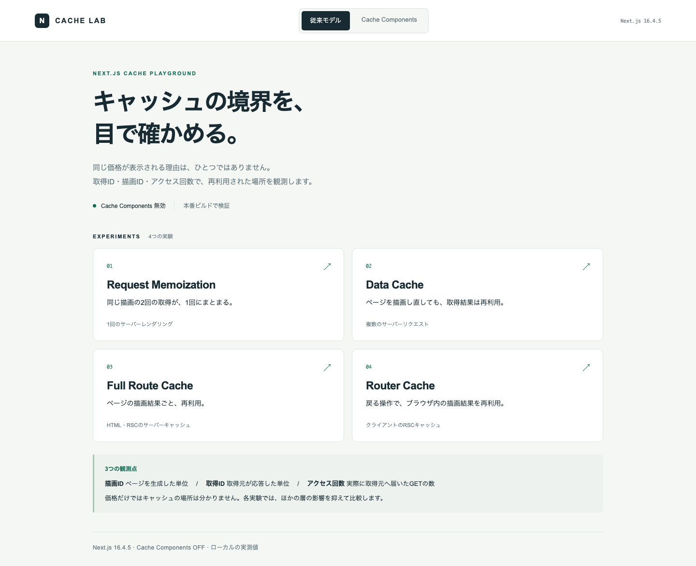
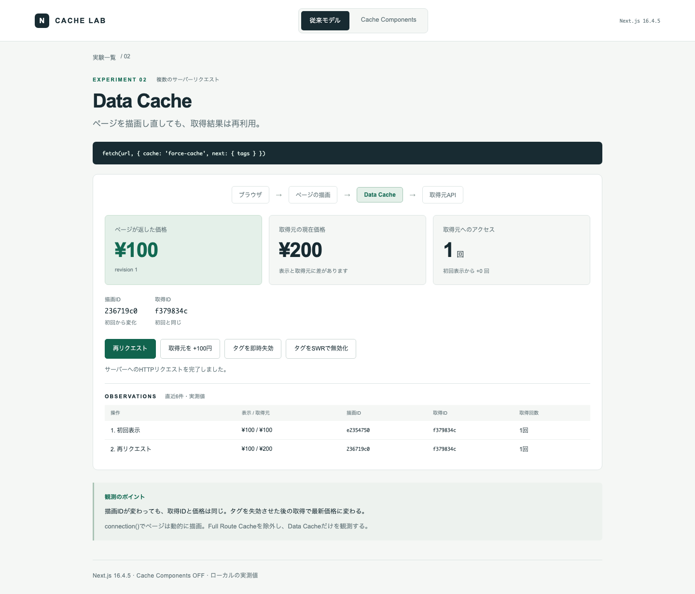

# nextjs-cache-playground

Next.js **16.4.5** のキャッシュを、本番ビルド・実際のHTTP通信・ブラウザ操作で検証する実験リポジトリ。
価格だけでなく **描画ID / 取得ID / 取得元へのアクセス回数** を表示し、再利用された場所を区別します。



## 起動

VoltaでNode.js **24.0.1**とYarn **4.7.0**を固定しています。Voltaをインストールし、このディレクトリでコマンドを実行すると、`package.json`の指定バージョンが使われます。Yarnは`node-modules`方式で依存関係を配置します。

```sh
yarn install --immutable
yarn lab
```

- <http://localhost:3200> — 従来モデル（Cache Components OFF）
- <http://localhost:3201> — Cache Components ON / Partial Prefetching ON
- `127.0.0.1:4200` — 計測用の取得元API（画面から間接的に操作）

`lab` は取得元APIを起動し、両アプリを **next build → next start** で起動します。起動ごとに両アプリの`.next`を削除し、取得元も新しい状態にします。初回ビルド中に行われる取得もアクセス回数に含みます。終了はCtrl+C。ポートが使われている場合は既存サーバーを停止してから実行してください。

`yarn dev` はUI編集用です。HMRなどの影響があるため、キャッシュの結論は本番モードで確認してください。

## 実験一覧

| 実験                | URL                | 期待する観測                                              | 他の層の制御                                          |
| ------------------- | ------------------ | --------------------------------------------------------- | ----------------------------------------------------- |
| Request Memoization | `:3200/memo`       | 2つのServer Componentの取得IDが一致。次の描画で取得回数+1 | `connection()` / `fetch: no-store`                    |
| Data Cache          | `:3200/data`       | 描画IDは変わるが取得IDは同じ                              | `connection()`でFull Route Cacheを除外                |
| Full Route Cache    | `:3200/full-route` | HTTPで要求し直しても描画IDが同じ                          | Data Cacheは併用。描画IDで識別                        |
| Router Cache        | `:3200/router/a`   | A→B→戻るでAの描画IDが再利用される。refreshで変化          | `prefetch={false}` / 動的ページ / `no-store`          |
| use cache           | `:3201/cached`     | 引数ごとに出力を再利用。タグ失効後に更新                  | 内側のfetchは`no-store` / 動的領域で呼び出す          |
| cacheLife           | `:3201/lifetime`   | 標準メモリハンドラーでは5秒後の要求で新しい値を待つ       | ブラウザのRouter Cacheを通さずHTTPで観測              |
| PPR                 | `:3201/ppr`        | 静的シェルとフォールバックの後に動的内容が届く            | 取得元に1.8秒の遅延。キャッシュされた共通データを併置 |

画面の「再リクエスト」はページのHTMLをHTTPで取得し、サーバーが出力したJSONを読み取ります。クライアントのRouter Cacheを通りません。Router Cacheの画面だけは実際の`Link`・`router.back()`・`router.refresh()`を使います。

## まず試す操作

1. Data Cacheを開く。表示価格と取得元の価格は100円。
2. 「取得元を +100円」で取得元だけを更新する。
3. 「再リクエスト」。表示は100円、取得元は200円。描画IDは変わり、取得IDは変わらない。
4. 「タグを即時失効」→「再リクエスト」。表示が200円になり、取得IDも変わる。



### 期限と無効化の読み方

- 「取得元を +100円」はキャッシュを無効化しません。
- 「タグを即時失効」はRoute Handlerから`revalidateTag(tag, { expire: 0 })`を実行。次の取得で新しい値を待ちます。
- 「タグをSWRで無効化」は`revalidateTag(tag, 'max')`を実行。次の取得では古い値を返しながらバックグラウンドで更新します。もう一度取得すると更新結果を観測できます。
- 「パスを再検証」は`revalidatePath('/full-route')`を実行。次のアクセスでページを再生成します。関連するData Cacheにも影響するので、Full Route Cacheだけの消去とは解釈しません。
- `cacheLife`の実験では`stale: 0, revalidate: 5, expire: 10`を使用。秒数はキャッシュ生成からの経過時間です。タイマーだけでは取得元へアクセスしません。中間アクセスで再検証すると期限の基点も更新されます。
- **標準メモリハンドラーの実測**：16.4.5の本番モードでは`revalidate`経過時にエントリーを破棄するので、5秒後の要求は新しい値を待ちます。時間経過によるSWRを保証するテストにはしていません。10秒の`expire`より先に破棄されるため、`expire`単独の効果もこの構成では分離できません。これは`revalidateTag(tag, 'max')`によるSWRとは別の経路です。[対象バージョンの標準ハンドラー実装](https://github.com/vercel/next.js/blob/v16.4.5/packages/next/src/server/lib/cache-handlers/default.ts)とテストを併せて参照してください。
- `stale`はクライアント側の再利用に関する値、`revalidate`と`expire`はサーバー側の更新に関する値です。この画面はHTTPでサーバー側を観測するため、`stale`によるRouter Cacheの挙動を検証するものではありません。

## 自動テスト

```sh
yarn playwright install chromium
yarn test:unit
yarn test
yarn typecheck
```

`yarn test`は取得元APIと両アプリを新規起動・本番ビルドして検証します。既に`yarn lab`が動いている場合は停止するか、明示的に再利用してください。

```sh
LAB_REUSE_SERVER=1 yarn test
```

| レベル                               | 役割                                                      |
| ------------------------------------ | --------------------------------------------------------- |
| UT（Node test runner）               | 計測用APIの取得カウンター・値の更新・キー分離を検証       |
| HTTP結合テスト（Playwright request） | 本物のNext.jsキャッシュを通してID・価格・回数を検証       |
| ブラウザE2E（Playwright Chromium）   | 戻る操作のRSC通信、refresh、PPRの到着順、操作パネルを検証 |

キャッシュAPIをモックしません。テストごとに異なるキーを使い、実行順による干渉を避けます。固定URLを使うFull Route Cacheとスクショの共有状態を考慮し、ワーカー数は1です。有効期限はサーバーの実時間で確認し、バックグラウンド更新の完了はポーリングで確認します。

## 記事用スクリーンショット

`docs/screenshots/`に、実際の操作から生成したPNGを同梱しています。

```sh
yarn screenshots
# 既存の本番サーバーを利用する場合
LAB_REUSE_SERVER=1 yarn screenshots
```

画面幅1440px・全体キャプチャで撮影します。PPRは読み込み中と完了後の2枚を出力します。スクショ内のIDは実行ごとに変わります。テスト失敗時のスクショ・trace・HTMLレポートも出力し、GitHub Actionsでは証拠一式をArtifactに保存します。

## 構成

- `apps/classic/` — 従来モデル。各ページにキャッシュ設定を明示
- `apps/components/` — `use cache`・`cacheLife`・PPR
- `shared/` — 表示、実測値の型、取得元アクセス、制御API
- `scripts/origin.mjs` — 価格・revision・取得回数を管理する独立プロセス
- `scripts/lab.mjs` — ビルドと3プロセスの起動・終了
- `tests/` — UT・結合テスト・E2E・スクショ生成

## 検証範囲

ローカルの単一Next.jsプロセスでの挙動を対象にしています。CDN・Vercelの分散キャッシュ・複数インスタンス間の共有・`use cache: remote/private`・ブラウザのHTTPキャッシュは別の実験が必要です。Partial Prefetchingは最新版の推奨設定としてONにしていますが、プリフェッチの詳細な組み合わせはこの実験の対象外です。

取得元の価格とカウンターはプロセス内メモリで管理し、再起動で初期化します。これは計測用のデータソースであり、Next.jsのキャッシュを模倣する実装ではありません。制御APIは学習用です。サーバーはループバックにのみbindし、公開運用を想定していません。

## 公式資料

- [従来のキャッシュモデル](https://nextjs.org/docs/app/guides/caching-without-cache-components)
- [use cache](https://nextjs.org/docs/app/api-reference/directives/use-cache)
- [cacheLife](https://nextjs.org/docs/app/api-reference/functions/cacheLife)
- [revalidateTag](https://nextjs.org/docs/app/api-reference/functions/revalidateTag)
- [Partial Prefetching](https://nextjs.org/docs/app/guides/adopting-partial-prefetching)
- [Playwrightでの検証](https://nextjs.org/docs/app/guides/testing/playwright)
